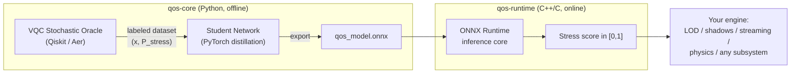

# QOS - Quantum Optimization System

Adaptive resource orchestration for game engines and other realtime systems.
The training data comes from a simulated quantum circuit, the runtime is a small
neural net exported to ONNX. It runs anywhere, costs well under 0.05 ms per call
and has no Python or quantum dependencies at runtime.

By [Kaan Esrefoglu](https://www.kestrogames.com), Kestro Games.

> Whitepaper: *Entangled Reality: A Hybrid Quantum-Classical Neural Architecture for
> Real-Time Stochastic Resource Orchestration* (2026), in [`paper/`](paper/).

## How it works



1. Game or system states (distance, object count, VRAM pressure, anything you
   measure) are angle encoded onto qubits, entangled through a configurable
   topology and biased toward risk aversion on the critical qubit. Sampling the
   circuit over 250k random scenarios produces a labeled dataset.
2. A small feed forward network (3-64-64-1 by default) learns that probability
   surface. The paper run lands at MAE 0.035.
3. The net is exported to ONNX and runs through `qos-runtime`, a small C++
   library with a plain C ABI. Any engine can call it: custom engines, Unreal,
   Godot, server side schedulers, robotics loops.

## Repository layout

| Directory | What it is |
|---|---|
| [`qos-core/`](qos-core/) | Python pipeline: VQC oracle, dataset generation, distillation, ONNX export. Config driven. |
| [`qos-runtime/`](qos-runtime/) | C++ inference library plus a C ABI for FFI (C#, Rust, Lua, anything). |
| [`adapters/`](adapters/) | Integration guides. Custom engines are the main target, Unreal is optional. |
| [`qos-bench/`](qos-bench/) | Benchmark protocol and analyzer, including the quantum vs classical ablation. |
| [`paper/`](paper/) | The whitepaper and the errata. |

## Quickstart (offline pipeline)

```bash
cd qos-core
pip install -e .

# Fast smoke run (small dataset, exact probabilities, quick training)
python -m qos_core all --config configs/smoke.yaml

# Full production run (v2 circuit, 128 shots, 250k scenarios)
python -m qos_core all --config configs/otuken_v2.yaml
```

Outputs land in `qos-core/artifacts/`: the dataset (`.npz`), the trained student
(`.pt`), the deployable model (`qos_model.onnx`) and a report (`report.json`).

## Runtime integration (any engine)

```c
#include <qos/qos_c.h>

qos_brain* brain = qos_brain_create("qos_model.onnx", 1);
float inputs[3] = { proximity, object_count, vram_usage };  /* normalized [0,1] */
float stress = qos_brain_evaluate(brain, inputs, 3);
/* stress in [0,1], use it to drive LOD, shadows, streaming, tick rates... */
qos_brain_destroy(brain);
```

[`adapters/custom-engine-guide.md`](adapters/custom-engine-guide.md) covers the
full integration pattern: evaluation cadence, smoothing, hysteresis and running
several agents at once.

## Results so far

A first measured comparison on one Unreal Engine 5.8 scene is in
[`qos-bench/unreal/RESULTS.md`](qos-bench/unreal/RESULTS.md). Short version:
the adaptive arms (qos and a classical control) both beat the baseline and a
static threshold rule by 7 to 10 FPS with a third of the stutters, and the
quantum labelled model and the hand tuned classical model land within run to
run noise of each other. No quantum advantage is claimed from that run. The
harness, the per knob switching costs and the protocol are documented next to
the results.

## About the quantum part

The circuit simulation is where all the training labels come from, so it is the
core of the system. Whether those labels actually beat a hand written heuristic
is a separate question, and it can only be answered with measurements. For that
reason `qos-core` ships two classical labelers (`threshold`, `logistic`) next to
the quantum one, and `qos-bench` defines the protocol for comparing them on real
frame time data. If a classical arm wins a comparison, that result gets
published too.

Implementing the paper circuit exactly as written also turned up three bugs in
the circuit design: a readout that ignores one input, a bias gate that cannot
affect measurements, and encoding wrap-around. The math is in
[`paper/errata.md`](paper/errata.md). The fixed v2 circuit behaves the way the
paper intended and is the default config.

## Roadmap

- [x] Config driven VQC data factory (ring / linear / full / cry topologies)
- [x] Distillation, ONNX export, runtime parity check
- [x] C++ runtime with C ABI
- [x] Unreal Engine 5.8 benchmark harness with stress injection (`qos-bench/unreal`)
- [x] First benchmark on a private scene: adaptive arms beat baseline, quantum vs classical labels at parity (`qos-bench/unreal/RESULTS.md`)
- [ ] Benchmark on a public scene so others can reproduce the numbers
- [ ] Eight input models benchmark (models trained, run pending)
- [ ] Godot / custom engine reference adapter
- [ ] Real QPU dataset slice (IBM Quantum)
- [ ] Multi agent Council orchestration layer

## License

Planned dual license: AGPL-3.0 for open use, commercial license for closed
source embedding. Details in [LICENSING.md](LICENSING.md).

## Citation

```bibtex
@techreport{esrefoglu2026qos,
  author      = {Kaan E{\c s}refo{\u g}lu},
  title       = {Entangled Reality: A Hybrid Quantum-Classical Neural Architecture
                 for Real-Time Stochastic Resource Orchestration},
  institution = {Kestro Games},
  year        = {2026},
  url         = {https://www.kestrogames.com}
}
```
